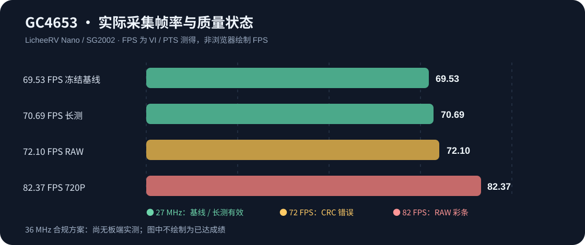
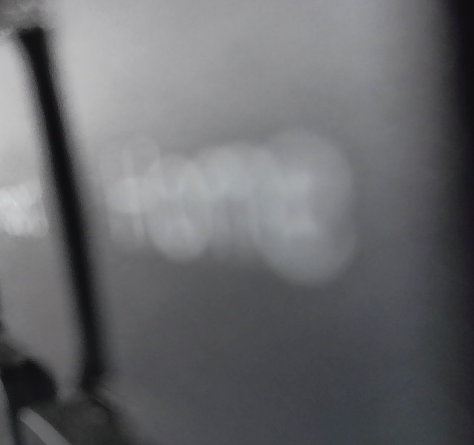
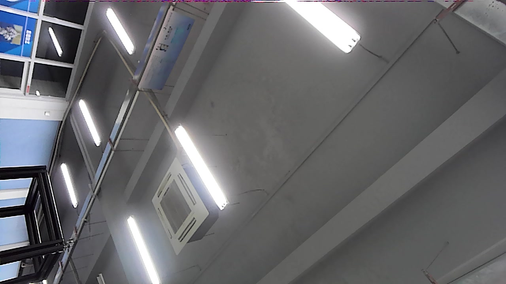
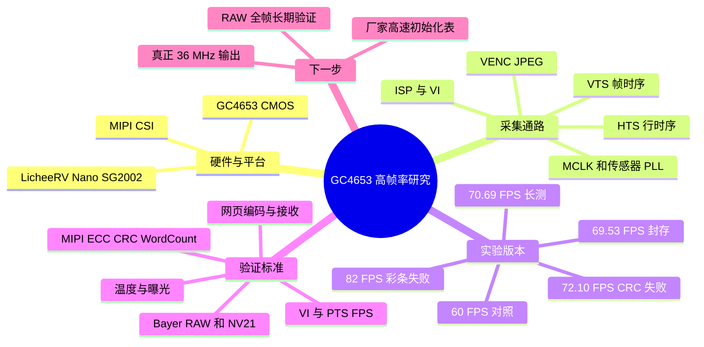
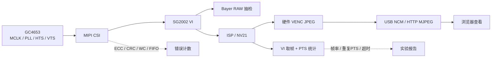

# LicheeRV Nano × GC4653｜高帧率摄像头采集与画质研究

  <strong>RISC-V SG2002 · GC4653 · MIPI CSI · ISP/VI · MJPEG · 时钟/HTS/VTS</strong>

> **研究性质 / Research prototype：** 探索在荔枝派 LicheeRV Nano 上提升 GC4653 实际采集帧率，同时验证原始图像是否出现彩条、掉帧、MIPI 错误与温升。**高 FPS 不等于稳定、无条纹和可量产。**

**2026-10-23 新进展：约36 MHz短时实机 A/B，获得真实约80 FPS和未压缩 Bayer RAW 顶部行改善证据。**

完整测试报告：[36MHz 分频实机实验：源码、原始RAW亮度分析和回退验证](test/clock36_live_20261023/RESULTS_36MHZ_20261023.md)。这不是经过物理示波器确认的正式36MHz驱动，也没有完成10分钟无条纹长测。

## 📍 关键结论

| 路线 | 输出 | 实测取帧率 | 时钟（方案标称） | 画质与稳定性 |
|---|---:|---:|---:|---|
| 保存基线 | 1920×1080 NV21 | **69.5319 FPS** | 27 MHz | 45 秒；零累计 MIPI 错误；仅少量 NV21 抽样检查 |
| 70 FPS 实验 | 1920×1080 NV21 | **70.6936 FPS** | 27 MHz | 112 秒长测；28 次 MIPI 读取均为零；并非全帧 RAW 完整验收 |
| 2026-10-22 实机恢复 | 1920×1080 / JPEG | **约 70.7–71.5 FPS** | 27 MHz | 预览和抓拍成功；检查时无新增 MIPI 错误；随温度升高帧率略降 |
| 72 FPS RAW 实验 | 1920×1080 RAW12 | **72.1007 FPS** | 27 MHz | **后期出现 22 次 CRC 错误，已停止**；仅用于实验参考 |
| 历史 80 档 | 1280×720 | **约 82.37 FPS** | 37.125 MHz | **顶部彩色条纹可在 Bayer RAW 中复现**，画质不合格；且高于某版 GC4653 数据手册 36 MHz 上限 |
| 36 MHz 分频短测（2026-10-23） | 1280×720 Bayer RAW12/JPEG | **约 80.0 FPS**（稳定短窗） | CAM1 分频33，推算约36MHz；CCF仍报37.125 | 1张RAW顶部异常亮行消失、切换后无新增MIPI错误；**尚非长期无花屏验收** |
| 原生36 MHz驱动路线 | 待验证 | **尚无正式实测** | 目标36MHz | 匹配内核的36MHz驱动与厂家配套高速初始化表尚未完成 |

以上分别是 **VI 采集 / PTS 统计**，不等于浏览器屏幕刷新率。历史高清 MJPEG 预览在 USB NCM 下 60 秒接收约 82.43 FPS；**该历史 80 档仍有彩条**。数据来源于仓库内的原始实验报告（链接见下）。

## 📷 画面对照

| 70 FPS 研究方案：真实抓拍局部 | 历史 80 档：顶部彩色条纹 |
|:---:|:---:|
|  |  |
| 来自 2026-10-22 实机，局部裁切仅用于隐私处理，**不能用于完整画质证明** | 历史采集异常，不是浏览器绘制导致的彩条 |

**原版实验图片、RAW/NV21 文件留在本地，并未全部公开**，详情见 [公开范围与完整归档](docs/PUBLICATION_SCOPE.md)。

## 🧠 项目思维导图

## 🔬 软件与数据链路

**目标：采集真正连续的高 FPS 原始图像，而不是插帧、裁掉彩条、伪造时间戳或仅提高 HTTP 发送速率。**

## 🗃️ 目录导览

| 目录 | 研究内容 |
|---|---|
| [speed-fry/](speed-fry/) | 720P 高速采集、MJPEG 高清预览、80 档上下游对照、彩条诊断 |
| [test/stable_69p5_1080p/](test/stable_69p5_1080p/) | 1920×1080、69.53 FPS 的冻结源代码与验证清单 |
| [test/over70_lab/](test/over70_lab/) | 1080P、HTS 1180、70.69 FPS 长测；运行器、监控与记录 |
| [test/stable_72p18_raw1080/](test/stable_72p18_raw1080/) | RAW12 72 FPS 研究快照（**CRC 错误，不是稳定版本**） |
| [test/clock36_safe_20261019/](test/clock36_safe_20261019/) | 36 MHz 内核模块路径研究和补丁记录（未完成实板验证） |
| [test/fps36_max/](test/fps36_max/) | 36 MHz 理论方案、前置检查 |
| [test/clock36_live_20261023/](test/clock36_live_20261023/) | 分频33≈36MHz实机 A/B、80FPS短测、完整 Bayer RAW12 顶部画质分析（短测，非量产） |
| [test/view70_20261022/](test/view70_20261022/) | 70 FPS 方案再次调出、实机帧率、JPEG 画面记录 |
| [licheervnano-gc4653-80fps-20261018/](licheervnano-gc4653-80fps-20261018/) | 较早的交接文档、校验和（SDK 和压缩包不上传） |
| [docs/](docs/) | [实验时间线](docs/EXPERIMENT_TIMELINE.md) · [复现与停止](docs/REPRODUCE.md) · [公开文件说明](docs/PUBLICATION_SCOPE.md) |

## 🚀 复现实验

板端须已配置相匹配的 **GC4653 驱动和 CVITEK SDK 运行库**，电脑与荔枝派通过 USB NCM/RNDIS 接通。**此仓库不是开箱即用镜像。** 参考 [详细复现步骤](docs/REPRODUCE.md)。

70 FPS 实验源代码及交叉编译产物：

`test/over70_lab/candidate_70p7/source/`

当前封存版本的关键参数：**27 MHz MCLK、HTS 1180、VTS 1200、1920×1080**。测试脚本会检验相机互斥状态并采样 MIPI 错误，不应在已有预览进程运行时强行启第二路。

浏览器预览实验使用 JPEG HTTP 服务（板端默认端口 8081），它是单客户端模式。**不推荐未检查温升就长期无人值守运行。**

## ⚠️ 已知问题和使用边界

1. **80 档彩条来自采集上游：** 在 Bayer RAW 上复现；禁用 TNR、DPC 与压缩不能解决，不能靠裁切、模糊、缩放掩盖。报告：[stripe-diagnostic/REPORT.md](speed-fry/stripe-diagnostic/REPORT.md)。
2. **72 FPS 并非稳定版本：** 历史 RAW12 试验中出现 CRC 增长，测试自动中止，不能在宣传材料中当作可靠吞吐。
3. **正式36MHz驱动仍未完成：** 2026-10-23 已通过 CAM1 硬件分频器做短时36MHz推定试验，得到约80FPS和RAW顶部画质改善，但 Linux debugfs 仍报37.125MHz，未物理测MCLK引脚。现用 MIPI 时钟枚举没有原生36MHz入口；不可把用户态寄存器直写当作安全量产驱动。
4. **温升可能相关，未证因果：** 70 档测试末期帧率下降，不能单凭板端 SoC 温度断言传感器热故障。
5. **报告是独立试验条件下的观测：** 采集 FPS、编码 FPS、网络接收 FPS、浏览器绘制 FPS 分别记录。

## 📚 主要资料

- [Sipeed LicheeRV Nano 硬件 Wiki](https://wiki.sipeed.com/hardware/zh/lichee/RV_Nano/1_intro.html)
- [MMF 开发指南](https://wiki.sipeed.com/hardware/zh/lichee/RV_Nano/8_mmf_development_guide.html)
- [Sipeed LicheeRV-Nano-Build](https://github.com/sipeed/LicheeRV-Nano-Build)
- [GC4653 历史资料与原始实验 README](docs/ORIGINAL_README_20261018.md)

## 📦 开源范围与版权

该仓库主要保存**自研实验源码、脚本、补丁、数据摘要与脱敏示意图**。第三方 SDK、交叉编译工具链、巨型 RAW/ISP 帧转储、原始压缩归档及包含人物/私人工作环境的照片不直接纳入 Git 历史。第三方软件仍受原版权/许可约束；本项目不因公开而自动改变其许可证。

项目为学习和硬件验证用途。**目前没有形成经过完整画质、长期稳定性和合法36MHz硬件验收的 80 FPS 正式驱动。**
