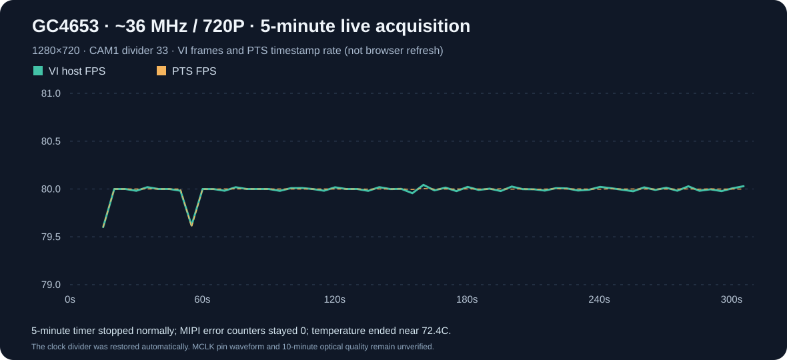
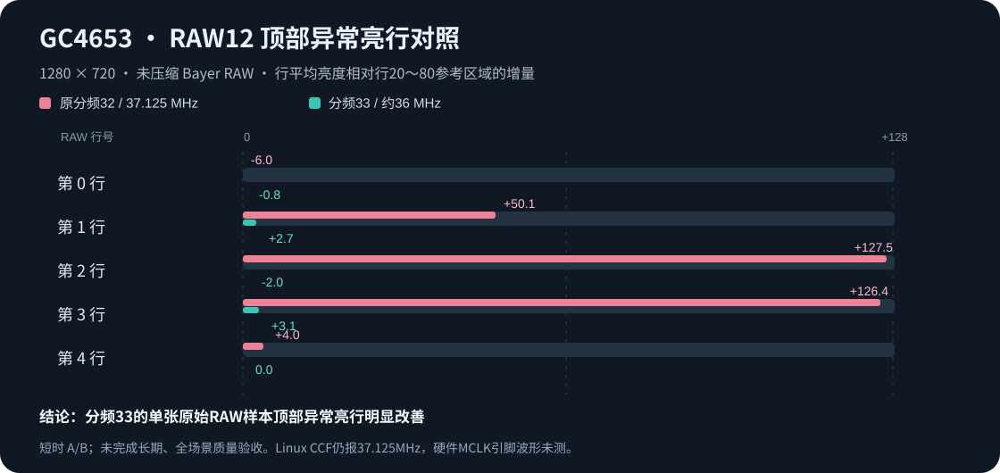
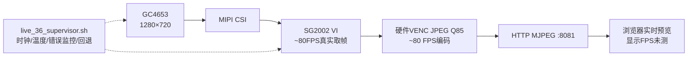

# LicheeRV Nano × GC4653 · 720P 80 FPS 高帧率采集

<p align="center">
  <strong>🏁 2026-10-23 研究里程碑 · 真实 VI/PTS 80 FPS · CAM1 分频33 · Bayer RAW 顶行异常显著改善</strong>
</p>

> **唯一推荐的开发入口：** [80 FPS 当前方案 → 源码、编译、部署、停机](test/clock36_live_20261023/README.md)。历史实验仅供追溯，不应当从旧目录直接启动摄像头。⚠️ 这是临时硬件分频的**研究版**，不是完成示波器验证与逐帧无花屏验收的量产驱动。

## 🏆 项目封面：80 FPS 已经真实跑通

| 1280 × 720 | 实测 VI 采集 | 连续运行 | 累计采集 | 错误与温度 |
|---|---:|---:|---:|---|
| **GC4653 / SG2002** | **80.0098 FPS** | **300 秒** | **24,222 帧** | MIPI 巡检 **97 次均 0**，SoC最高 **72.4°C** |

这是 **LicheeRV Nano + GC4653 在这台开发板上的实机测量**，不是软件插帧：VI成功取帧、PTS时间戳与约80 FPS吻合。另一次完整300秒复测得到 **24,252帧**，最后5秒窗口 **80.0179 FPS**，无取帧超时、重复PTS和JPEG编码错误；该复测在分频切换**之前**已有累计 `WcErr=1`，之后没有继续增加。



<details>
<summary>查看这次里程碑的完整证据</summary>

- [五分钟实验报告](test/clock36_live_20261023/LIVE_5MIN_RESULTS.md)：运行结果、温度、MIPI、恢复证据
- [可复核 JSON](test/clock36_live_20261023/LIVE_5MIN_SUMMARY.json) · [每5秒原始数值 CSV](test/clock36_live_20261023/LIVE_5MIN_WINDOWS.csv)
- [真正运行的 C++ 采集/编码/HTTP 源码](test/clock36_live_20261023/camera_36long.cpp)
- [唯一推荐的板端受监督启动方案](test/clock36_live_20261023/live_36_supervisor.sh)
- [完整可重新编译公共对象的构建脚本](test/clock36_live_20261023/build_long.sh)
- [原始 Bayer RAW12 行级诊断](test/clock36_live_20261023/raw12_analysis.json)

</details>

### 画质里程碑：80 FPS 不再是过去那套有彩条的 82 FPS



历史 37.125MHz 模式虽然测得约 82.4 FPS，却在**传感器 Bayer RAW 顶部第2/3行**发现明显异常，JPEG也可见紫红条纹。新方案将 CAM1 时钟的硬件分频从 **÷32 改成 ÷33**：依据父时钟 **1,187,999,988 Hz** 计算 MCLK **约35,999,999.64Hz（约36 MHz）**，实际采集约80 FPS。多次 Bayer RAW 抽样的顶部异常峰值明显下降，现场 JPEG 抽看没有明显历史彩条。

**这并不代表画面绝对无损：** 浏览器预览使用 JPEG Q85，属于有损编码。RAW 样本虽关闭VI压缩，但不是所有80FPS帧的全图质量审计。Linux Common Clock Framework仍显示原缓存值37.125MHz，**GC4653实体 MCLK 引脚尚未用示波器验证**，所以不能将临时 `devmem` 分频脚本当成正式驱动。

## ▶️ 只保留当前这一条推荐调用链



**项目当前唯一推荐源码/构建/运行管理文件：**

| 文件 | 负责什么 |
|---|---|
| [`camera_36long.cpp`](test/clock36_live_20261023/camera_36long.cpp) | 原版GC4653 80档初始化、VI实际取帧、RAW诊断、JPEG Q85硬件编码、单客户端HTTP预览 |
| [`build_long.sh`](test/clock36_live_20261023/build_long.sh) | 从匹配的外部Sipeed SDK源码构建公共对象及程序；旧构建脚本不再需要 |
| [`live_36_supervisor.sh`](test/clock36_live_20261023/live_36_supervisor.sh) | 检查摄像头独占、切分频33、300秒上限、SoC温度74.5°C上限、MIPI错误监测、恢复分频与释放锁 |

板端已经部署了此次实机验证的冻结二进制时，在确认摄像头空闲、分频寄存器为原值并且SoC温度正常后，**直接在板端前台运行**：

```sh
sh /tmp/clock36_live_20261023/live_36_supervisor.sh
```

它使用板端 `/tmp/clock36_live_20261023/camera_36long`，不是在 `/code/camera/bin` 覆盖旧应用。实时网址（仅运行期间且电脑可达 USB NCM 时有效）：

- 网页：`http://10.133.124.1:8081/`
- 视频流：`http://10.133.124.1:8081/live.mjpg`
- 单帧：`http://10.133.124.1:8081/snapshot.jpg`

**退出：** 前台 `Ctrl+C` 或运行达到300秒、温度/错误保护时将正常退出，恢复 `0x00200001` 分频寄存器并释放 `/code/camera/run/lock`。不要直接 `kill -9` 或强删锁目录。重启前必须核查设备状态。完整部署/编译和可复核SHA-256见 [当前方案交接手册](test/clock36_live_20261023/README.md)。

### 80 FPS 究竟是哪一层？

| 阶段 | 已验证的数据 | 解释 |
|---|---|---|
| 摄像头 → SoC VI | **约80 FPS** | 真实硬件采集取帧；PTS约80，非插帧 |
| SoC VENC 编码 JPEG | **约80 FPS** | JPEG Q85硬件编码，**有损** |
| USB NCM / MJPEG 发送 | 有连接的时间窗口可达约79～80 FPS | 由板端成功发送统计，不是浏览器绘制帧率 |
| 浏览器渲染/显示器 | **未单独测量** | 浏览器解码、刷新率、屏幕60/120/144Hz等因素限制可见画面 |

## 📚 每次失败和进步都有资料

**本次清理不是忘记过去，而是只保留一个有效启动入口。** 已经从主分支退役 **109个旧启动/停止/构建/实验调用及板端辅助脚本**。删除之前逐一归档了名称、SHA-256、用途、Git旧版链接，完整源码可从 Git 历史固定提交恢复，避免交接人重复踩坑。**历史C++研究源码、技术说明、指标JSON等仍保留在仓库**，但不是当前可用入口。

| 历史阶段 | 实测帧率 / 结果 | 状态 |
|---|---|---|
| 27MHz 720P 传统方案 | 约60FPS，RAW抽检无旧顶行彩条 | 早期基线 |
| 37.125MHz 720P | 约82.4FPS，**Bayer RAW顶部彩条** | **失败：质量不通过** |
| 27MHz 1080P / HTS1200 | **69.5319FPS**，45秒零新增MIPI | 重要保存成果 |
| 27MHz 1080P / HTS1180 | **70.6936FPS**，112秒长测、28次MIPI为零 | 重要保存成果 |
| 更激进 1080P RAW12 | **72.1007FPS**，后期CRC增长22次 | **失败：不稳定** |
| 内核36MHz枚举补丁 | 补丁已写，原内核ABI不匹配 | 研究中，不是上板可用驱动 |
| CAM1分频33/约36MHz 720P | **80.0098FPS**，5分钟采集，RAW抽样顶部正常化 | **当前里程碑方案** |

<details>
<summary>展开全部研究、源码历史与交接资料</summary>

- **[逐次方案对比、尝试顺序、失败原因与决策过程](docs/history/EXPERIMENT_DECISIONS.md)**：包含从30FPS到80FPS的17项阶段试验
- **[109个旧调用脚本逐个记录、SHA-256和删除前Git源码链接](docs/history/RETIRED_LAUNCHERS.md)**
- [长周期测试原始时间线](docs/EXPERIMENT_TIMELINE.md)
- [当前环境、部署及停止说明](docs/REPRODUCE.md)
- [公开范围与本地完整档案](docs/PUBLICATION_SCOPE.md)
- [冻结旧研究资料快照](https://github.com/kalapaopao/LicheeRV-Nano-GC4653/tree/8fe1a520aeb29387d9e4bc30cf44bf8c35057ac1)

</details>

## 🎥 已实测的录像采集模块（独立）

新增 [录像模块 modules/record80](modules/record80/README.md)：在保持 **1280×720、约80FPS真实取流** 的基础上，使用已验证的硬件 JPEG Q85 通道录制 **MJPEG AVI（目标40FPS、实测短测38.53FPS）**；原生AVI写盘，录像/丢帧统计、网页启停、监督守护、板端视频下载与训练抽帧。

- [录像使用手册](modules/record80/docs/USER_GUIDE.md) · [开发交接](modules/record80/docs/HANDOFF.md) · [实测验收报告](modules/record80/docs/TEST_REPORT.md)
- 原80FPS研究代码和历史失败方案继续保留；录像模块不覆盖取流基线，不把80FPS采集误写为80FPS录像。

当前 80FPS 主线入口见 [80FPS 工程说明](docs/80FPS_ONLY.md)。板端模型使用 `fly_rm_320_int8.cvimodel`，通过 `FLY_RM_MODEL` 启用实时推理。

## 🔭 下一阶段

1. 用匹配板端的 kernel/ABI 把合法36MHz请求纳入 Linux CCF 正式时钟驱动，消除寄存器和 `clk_get_rate` 的状态不一致。
2. 用示波器实测GC4653模组 MCLK 输入波形和频率，并核对厂家传感器PLL/MIPI高速寄存器表。
3. 连续≥10分钟，跨亮场/暗场/运动/温升，做**逐帧 Bayer RAW 全图**的彩条/坏行检测，而不是只抽三张。
4. 若未来要证明“浏览器真的显示80FPS”，新增客户端帧序号、接收时间戳及渲染率的独立测试，区分网络送达与显示器刷新。

## 使用须知

- 项目资料和代码在 Windows **`D:\study\LicheeRV`**；旧目录 `speed-fry/`、`test/over70_lab/` 等保留为**历史只读研究证据**，不再包含主分支可执行的旧启动方案。
- 完整 SDK、板端 RISC-V 已编译二进制、原始 RAW/NV21/JPEG、个人环境画面不随 Public GitHub 公开；仓库保留核心源码、静态指标、工作流和图表。详情见 [PUBLICATION_SCOPE.md](docs/PUBLICATION_SCOPE.md)。
- 本仓库不包含可直接运行的整机镜像。官方基础资料：[Sipeed LicheeRV Nano Wiki](https://wiki.sipeed.com/hardware/zh/lichee/RV_Nano/1_intro.html) · [Sipeed LicheeRV-Nano-Build](https://github.com/sipeed/LicheeRV-Nano-Build)。
- **技术免责声明：** 当前方案是该板该环境的研发里程碑，未完成正式驱动、物理时钟及逐帧画质认证；不同硬件/温度/曝光下请重新验证，不用于无人值守量产。
