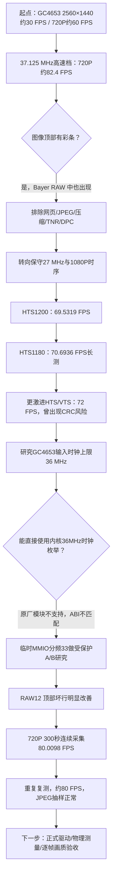

# GC4653 高帧率研究：历代方案、失败证据与决策过程

> 研究设备：LicheeRV Nano (SG2002) + GC4653，RISC-V Linux `5.10.4-tag-`。本页是**技术交接档案**，不再是启动命令合集。当前唯一推荐的实验启动方案见 [80 FPS 里程碑](../../test/clock36_live_20261023/README.md)。
>
> 旧运行器的逐文件清单、SHA-256 和**删除之前完整源码的 Git 链接**：[RETIRED_LAUNCHERS.md](RETIRED_LAUNCHERS.md)。旧代码曾真实存在，并非凭空整理或永久抹去。

## 一、研究主线：为什么最后选分频33

### 研究里程碑总表

“成功”仅代表对应观察窗口内该项测试通过；明确出现错误的方案保留为失败证据。不同测试的 resolution / pixel format / duration 不可直接等价。

| 次序 | 技术尝试与具体调整 | 实测结果 | 结论/为何保留或退役 | 证据 |
|---|---|---|---|---|
| 1 | 板端原生样例，2560×1440 | 约30 FPS | 基础采集链路可用，但不满足80帧目标 | [历史 speed-fry](../../speed-fry/README.md) |
| 2 | 720P，27 MHz / 60 档 | 约60 FPS，RAW抽检无历史顶行彩条 | 稳定低速对照 | [彩条隔离报告](../../speed-fry/stripe-diagnostic/REPORT.md) |
| 3 | 720P，旧高速模式 MCLK=37.125 MHz | VI约82.4–82.5 FPS；高清NCM接收单独测得约82.43 FPS | **性能通过，画质失败**；Bayer RAW本身出现顶行异常；高于所用手册36MHz边界 | [隔离报告](../../speed-fry/stripe-diagnostic/REPORT.md)、[高清传输](../../speed-fry/PREVIEW-HD.md) |
| 4 | 保持80档，修改 VI TILE / NONE 压缩属性 | 彩条不消失 | 不是简单的压缩布局错读 | [隔离报告](../../speed-fry/stripe-diagnostic/REPORT.md) |
| 5 | 保持80档，关闭 ISP TNR | 彩条仍在，噪声增加 | **拒绝**：降噪算法不是上游坏行根因 | [隔离报告](../../speed-fry/stripe-diagnostic/REPORT.md) |
| 6 | 保持80档，关闭静态与动态 DPC | 彩条仍在 | **拒绝**：坏点校正不是顶端异常主因 | [隔离报告](../../speed-fry/stripe-diagnostic/REPORT.md) |
| 7 | 直接检查 ISP 前 Bayer RAW，与 JPEG 对照 | RAW 顶部第2/3行异常；80→60→80再现/消失/再现 | 把故障定位到传感器/高速采集上游；不能靠网页CSS裁边掩盖 | [隔离报告](../../speed-fry/stripe-diagnostic/REPORT.md) |
| 8 | USB NCM / RNDIS、多客户端与网络帧率调优 | NCM 60秒 JPEG 接收达约82.43 FPS，但旧彩条仍在 | 网络瓶颈和图像真实质量是**两个独立问题** | [预览带宽记录](../../speed-fry/PREVIEW-HD.md) |
| 9 | 1080P，27 MHz、HTS=1200 | **69.5319 FPS**，45秒窗口MIPI错误0 | 1080P成果单独封存；NV21抽样未见旧条纹，非全帧RAW验收 | [封存69.5](../../test/stable_69p5_1080p/README.md) |
| 10 | 1080P，27 MHz、HTS=1190 | 约69.711 FPS，但WordCount错误1 | **退役**：稍高FPS不足以弥补链路错误 | [70 FPS报告](../../test/over70_lab/RESULTS_70FPS_20261019.md) |
| 11 | 1080P，27 MHz、HTS=1180 | 112秒**70.6936 FPS**，28次MIPI读取为零，NV21抽样未见旧顶行突变 | 高分辨率重要阶段成果；仍受温升、传感器曝光等因素制约 | [70 FPS报告](../../test/over70_lab/RESULTS_70FPS_20261019.md) |
| 12 | 1080P，更激进HTS1165/VTS1140，RAW12 | 测得**72.1007 FPS**，随后CRC增长至22并中止 | **不列为稳定方案**；应保留错误样本 | [技术时间线](../EXPERIMENT_TIMELINE.md)、[72 FPS实验](../../test/stable_72p18_raw1080/) |
| 13 | 36MHz原厂驱动补丁与新枚举6 | 找到CAM0PLL÷33数学时钟方案，但缺少与板端内核匹配的模块ABI及完整构建条件 | **代码/静态研究成立，内核正式36MHz运行未完成**；不随意替换ko | [36MHz预研](../../test/clock36_safe_20261019/STATUS_20261019.md)、[内核工作](../../test/kernel36/RESULTS_2026-10-19.md) |
| 14 | CAM1 MMIO `0x030028c4` 分频32→33，2秒回退 | 寄存器能写入读回；debugfs仍报37.125MHz | 验证只针对硬件寄存器，不是时钟管脚实测；CCF软件状态可能不同步 | [36MHz短测](../../test/clock36_live_20261023/RESULTS_36MHZ_20261023.md) |
| 15 | 720P 80档启动后，短时临时切分频33并读未压缩RAW12 | VI约80 FPS；未压缩packed Bayer RAW顶部异常亮行大幅改善 | **有效突破**：不是裁图/模糊/插帧；但仍为抽样 | [36MHz短测](../../test/clock36_live_20261023/RESULTS_36MHZ_20261023.md) |
| 16 | 分频33，板端 C++ + JPEG网页 + 独占锁 + 自动回退，300秒 | **24,222帧；累计80.0098 FPS；MIPI97次巡检均0；最高72.414°C** | **本项目主线里程碑**；真实VI帧率，正常恢复分频，RAW抽样改善 | [5分钟完整报告](../../test/clock36_live_20261023/LIVE_5MIN_RESULTS.md) |
| 17 | 相同主方案再次实机运行300秒、换场景/取图 | 约80.01 FPS，最终总帧数**24,252**，结束无编码错误，分频恢复；启用36MHz前已有WcErr=1，运行后未增加 | 抽样JPEG无明显彩条；对 RAW 做奇偶行亮度校正后顶行突变改善；不是所有帧质量证书 | [二次复查归档](../../test/clock36_live_20261023/README.md)（完整原始日志本地保留） |

## 二、故障排查的因果关系

### 为什么以前80帧看见彩条，今天80帧却好很多？

早期80档以37.125MHz输入，超过所用GC4653手册36MHz fSCK上限。彩条也出现在ISP之前的Bayer RAW，证明**这不是浏览器绘制、缩放、JPEG质量或USB网络插入的条纹**。将CAM1分频从32改为33后，计算输入时钟约36MHz，同时真实取帧率从约82.5降到80左右，Bayer RAW异常亮行显著改善。这些观测**支持高于手册上限的时钟与坏行相关**，但还不是电气层示波器证明，更不能推出所有模组与环境都会零异常。

### 为什么降分辨率未自动解决？

帧率受传感器PLL、输出像素时钟、行周期HTS、帧周期VTS、曝光、MIPI链路和VI取帧共同约束，不是只降分辨率就一定线性升高。1080P上的HTS尝试说明：越激进的时序可能带来CRC/WordCount错误。**从算法视角必须同时看FPS和真实图像完整性。**

### 温度、裸RAW与浏览器各自是什么角色？

- 温度记录为SoC温度，不是GC4653结温；70FPS长测里温升与帧率变化同步，但不能证因果。
- Bayer RAW 是传感器/ISP之前的抽样证据，能发现JPEG视觉优化掩盖的坏行；**一张RAW不能证明每帧正常**。
- VI取帧约80、JPEG编码约80和某时段MJPEG发送约80，不等于浏览器实际显示80。60Hz屏幕通常最多显示60次不同刷新；浏览器FPS需另设计接收时间戳与RAF指标，避免把到达率伪装成显示率。
- 原始 Bayer 存储为packed RAW12（1280×720×1.5字节），不代表公网浏览器MJPEG无损：**JPEG Q85属有损压缩**。

## 三、明确放弃的路径

1. 不再把37.125MHz的82FPS当作可交付方案；它在RAW证明有顶部异常。
2. 不再反复通过关闭TNR/DPC、TILE或CSS裁边解决上游彩条；此前实验已否定。
3. 不再将72FPS且CRC增加的1080P方案标注为稳定。
4. 不在缺少匹配内核ABI、备份和回退检查的情况下直接替换 `soph_mipi_rx.ko`。
5. 不再公开多个同时可用的启动入口（几十个旧 .sh/.py）；这些入口进入 Git历史并由[逐项清单](RETIRED_LAUNCHERS.md)可查。

## 四、保留历史与交接规则

- **当前主分支唯一推荐方案：** [80FPS实现与启动交接](../../test/clock36_live_20261023/README.md)，源码 `camera_36long.cpp`、构建 `build_long.sh`、板端管理 `live_36_supervisor.sh`。
- **历史成果与旧代码不抹去：** 历史 C++、硬件补丁、JSON、README 等研究资料继续保存在旧实验目录；删掉的脚本在先前提交 `8fe1a52` 有完整内容及SHA。
- **本地大文件不提交：** 外部 SDK、.o、RISC-V 可执行文件、Bayer RAW、NV21、原始 JPEG 与包含人物/私人空间的画面继续保存在 `D:\study\LicheeRV`，Git忽略不删除。
- **未来目标：** 驱动内通过匹配ABI/CCF正规设置36MHz，示波器测真实传感器MCLK引脚，做≥10分钟更高强度逐帧画质检验，覆盖温升/亮暗场/运动与不同模组。

## 五、复原旧算法（仅研究，不代表可以直接运行）

从 [固定 Git 快照 8fe1a52](https://github.com/kalapaopao/LicheeRV-Nano-GC4653/tree/8fe1a520aeb29387d9e4bc30cf44bf8c35057ac1) 可查看删除之前全部脚本。**严禁直接在板端覆盖当前可用的相机二进制、原驱动或脚本；任何历史重测先独立建目录备份并做独占检查。**
